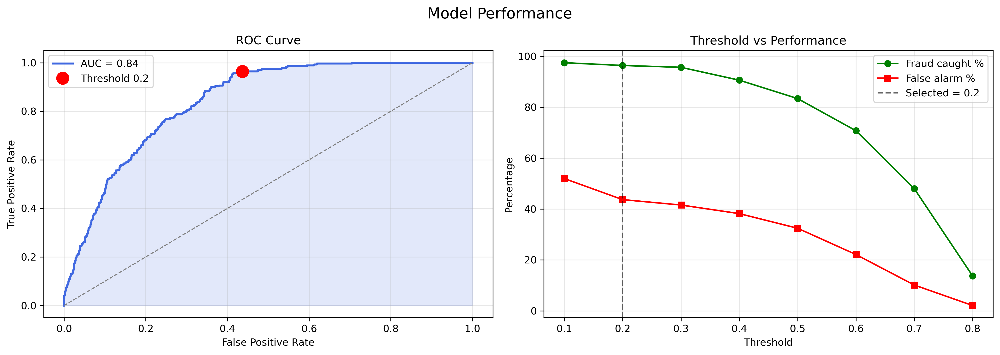
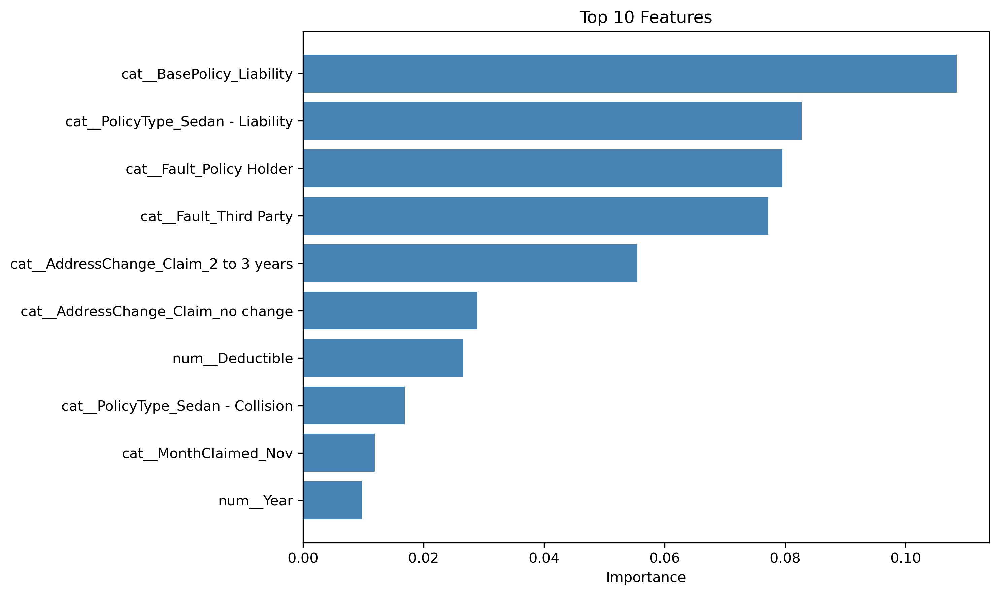

# Vehicle Insurance Fraud Detection

Binary classifier that ranks vehicle insurance claims by fraud risk, plus a cost analysis to pick a decision threshold.
Built for the NEXIS Student Research Club at Syracuse University (Python, scikit-learn, XGBoost).

- data: [Kaggle vehicle claim fraud dataset](https://www.kaggle.com/datasets/shivamb/vehicle-claim-fraud-detection) - 15,420 claims from 1994-96, ~6% fraud
- split: 70/30, with all model + threshold decisions made on the training set (5-fold CV) and the test set scored once
- notebook: `fraud_detection.ipynb`

## Results

If investigators can only review the riskiest claims:

| Claims reviewed (highest risk first) | Random 70/30 split: fraud caught (lift) | Train 1994-95, test 1996: fraud caught (lift) |
|---|---|---|
| Top 5% | 23.1% (4.6x) | 9.9% (2.0x) |
| Top 10% | 39.7% (4.0x) | 17.4% (1.7x) |
| Top 20% | 62.8% (3.1x) | 39.4% (2.0x) |
| AUC | 0.842 (95% range 0.823-0.859) | 0.759 |

The random split has 4,626 test claims (277 fraud), and its top-10% lift is roughly 3.5x to 4.5x across bootstrap resamples. It mixes all three years together, so treat it as the optimistic number. The later-year split (4,083 claims, 213 fraud) is the more realistic test of how the model would do on new claims.



**Cost view:** the cheapest threshold (0.2) catches 96.4% of fraud but flags 46.8% of claims, saving $3.46M on the test set vs. paying every fraud claim. Under my cost assumptions, though, just investigating *every* claim saves about $3.0M, so the model only adds ~$0.46M. Its real value is **ranking** claims when review capacity is limited.

XGBoost, hist gradient boosting, and random forest all scored about the same in cross-validation, so I kept XGBoost. Top features: liability base policy, sedan liability policy type, fault, and recent address change.



## Problems I found and fixed

- **Row ID leak:** `PolicyNumber` is just a row number, and the file is in time order. Leaving it in raised CV AUC from 0.827 to 0.874, so I dropped it. An earlier version kept it and reported ~0.88 test AUC, which was too high.
- **Unfair comparison:** the other models used SMOTE and XGBoost didn't. Now they all use class weights.
- **Accuracy:** calling every claim legit is already 94.0% accurate, so I report lift, recall, and precision instead.
- **Test set:** I first picked the model and threshold by looking at test results. Now that all comes from the training set.

## Assumptions + limitations

- the $15K average fraud payout and $250 per investigation are **assumptions** - the data has no claim amounts
- savings assume every investigated fraud claim gets stopped, and they're test-set figures, not annual
- feature importance is XGBoost's built-in importance on one-hot columns, so read it as directional
- the data is from 1994-96, so this is a methods project, not a production fraud system

## How to run

```bash
git clone https://github.com/dprindfu/insurance-fraud-detection.git
cd insurance-fraud-detection
pip install -r requirements.txt
jupyter notebook fraud_detection.ipynb
```

The notebook downloads the dataset with `kagglehub`. If the download asks for credentials, set up a Kaggle API token first ([instructions](https://github.com/Kaggle/kagglehub#authenticate)). Plots are saved to `outputs/`.
